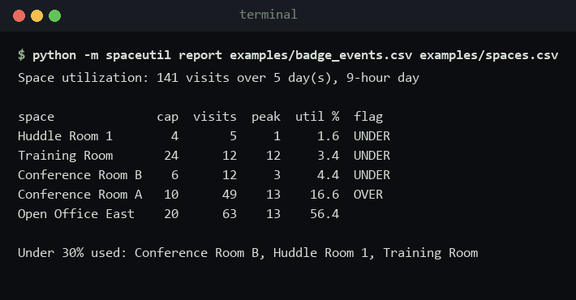

# space-utilization-analyzer

Turns badge-in and badge-out records into a utilization table for rooms and zones.



## What it is for

Offices pay for space that often sits empty while other rooms are overbooked. A workplace or facility manager needs numbers before deciding to merge, resize or close a room. This tool reads badge visit records and a list of room capacities, then shows how full each space really is, which ones are barely used and which ones went over capacity. Utilization here means the person-hours used divided by the person-hours the room could hold.

## Install

```
cd space-utilization-analyzer
python -m pip install -e .
python -m pip install pytest
```

## How to use

| I want to | Command |
|---|---|
| See utilization for every space | `python -m spaceutil report EVENTS.csv SPACES.csv` |
| Change the "under used" line (default 30 percent) | `--low 20` |
| Change the hours a space is available per day (default 9) | `--day-hours 10` |
| See average people per hour in one room | `python -m spaceutil hourly EVENTS.csv SPACES.csv "Conference Room A"` |

Files: `SPACES.csv` has `space,capacity`. `EVENTS.csv` has `badge,space,entry,exit` with times as `YYYY-MM-DD HH:MM`. Both are in `examples/` with invented data.

Worked example:

```
python -m spaceutil report examples/badge_events.csv examples/spaces.csv
```

```
Space utilization: 141 visits over 5 day(s), 9-hour day

space              cap  visits  peak  util %  flag
Huddle Room 1        4       5     1     1.6  UNDER
Training Room       24      12    12     3.4  UNDER
Conference Room B    6      12     3     4.4  UNDER
Conference Room A   10      49    13    16.6  OVER
Open Office East    20      63    13    56.4  

Under 30% used: Conference Room B, Huddle Room 1, Training Room
```

## How it works

- Each visit is one badge in one space from entry to exit.
- Peak is the most people inside at the same moment, found by sorting all entries and exits by time. An exit and an entry at the same minute do not overlap.
- Utilization is total visit hours divided by capacity times day hours times the number of distinct days in the file.
- OVER means the peak passed capacity. UNDER means utilization is below the `--low` percent.
- The `hourly` command splits each visit across the clock hours it touches (08:00 to 17:00) and averages over the days seen.

## Limits

- Badge data shows who entered, not who stayed. A person who badges out late inflates the numbers.
- Every day in the file counts as a full day, including days with few records.
- Times are read as local time on the same day. A visit that crosses midnight is not split.
- Reports and charts are plain text.

## License

MIT. Copyright 2026 Yassine Emhamed.
